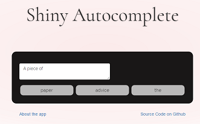

# Shiny Autocomplete
### Statistical language modeling in an interactive R application

An English word-prediction and completion app built with R and Shiny. It turns corpus-derived trigram counts into suggestions that update as the user types, and lets the user insert a suggestion with a click.

**Original development:** December 2016–March 2017 · **Author:** Sascha Coridun  
**Context:** Coursera Data Science capstone · **Stack:** R, Shiny, data.table, memoise

The original implementation was written without AI coding assistance. This README was refreshed with AI assistance in November 2026; the historical source code and commit history are preserved.



## Project overview

I built the corpus-processing pipeline, prediction logic, and Shiny interface for a data-science capstone. The project connects statistical NLP with interactive software: generating compact frequency data, ranking candidate words, and reusing computations while a user types.

- Predict the next word after a space.
- Complete a partially typed word using its prefix.
- Display up to three suggestions as clickable buttons.
- Cache predictions for previously encountered contexts.

## How it works

1. **Prepare the corpus.** `getTrigrams.R` reads English news, blog, and Twitter text from the course corpus, samples lines, normalizes text, and computes trigram counts.
2. **Restrict the vocabulary.** The preparation script retains the 5,000 most frequent candidate words and filters trigrams to that vocabulary.
3. **Score candidates.** The server uses the two preceding words to look up trigrams, falling back to bigram and unigram counts derived from the same table when necessary.
4. **Reuse results.** Keyed `data.table` lookups and `memoise` support repeated queries. For an unfinished word, the app filters candidates by prefix.
5. **Update the interface.** Shiny renders suggestion buttons and inserts the selected word into the text field.

The original presentation describes the approach as *Stupid Backoff*. The preserved code applies a factor of 0.4 to both bigram and unigram fallback scores; it does not accumulate the penalty across two fallback levels. These are ranking scores, not calibrated probabilities.

## Run locally

From a checkout of this repository, install the application dependencies in R:

```r
install.packages(c("shiny", "data.table", "memoise"))
shiny::runApp("app")
```

The application reads the included `app/trigramFrequencies.csv`; rebuilding the corpus is not required to explore the app.

**Compatibility:** these instructions are based on source inspection. The application has not been rerun during the November 2026 documentation refresh. Historical package versions are not pinned.

### Rebuilding the frequency table

The optional preparation script additionally loads `text2vec`, `dplyr`, `tidytext`, `tidyr`, `tokenizers`, `parallel`, and `doParallel`.

Before running it:

- Obtain the [original course corpus](https://d396qusza40orc.cloudfront.net/dsscapstone/dataset/Coursera-SwiftKey.zip).
- Adapt the hard-coded working directory and corpus paths in `getTrigrams.R`.
- Review the historical package APIs against your installed versions.
- Copy its generated `trigramFrequencies.csv` into `app/`.

The script reads up to 300,000 lines from each source and samples 30% of those lines. It does not set a random seed, so regenerating the table will not necessarily reproduce the committed artifact.

## Repository guide

| Path | Purpose |
| --- | --- |
| [app/server.r](app/server.r) | Candidate scoring, caching, input handling, and Shiny server |
| [app/ui.r](app/ui.r) | Application layout |
| [app/www/](app/www/) | JavaScript and styling |
| [app/trigramFrequencies.csv](app/trigramFrequencies.csv) | Precomputed frequency table |
| [getTrigrams.R](getTrigrams.R) | Historical corpus preparation script |
| [milestoneReport/](milestoneReport/) | Exploratory corpus reports |
| [presentation/](presentation/) | Original project presentation and screenshot |

## Historical resources and limitations

- [Original hosted app](https://saschac.shinyapps.io/shinyAutocomplete/) — historical deployment; current availability is unverified.
- [Original presentation](http://rpubs.com/SaschaC/shinyAutocomplete) and [corpus exploration report](https://rpubs.com/SaschaC/CourseraCapstoneProject) — external historical resources.
- [Original source snapshot](https://github.com/SaschaC/capstone/tree/1896e143177494d724de8f0698461e83a93c908f) and [development history](https://github.com/SaschaC/capstone/commits/master/).

The model uses a short context and restricted vocabulary. It does not model long-range meaning, and the repository does not establish predictive accuracy on a held-out benchmark. Performance figures in the original presentation describe the historical environment.

The course provided the project context and corpus. Third-party packages and corpus materials retain their respective terms; this documentation refresh does not introduce a software license.

